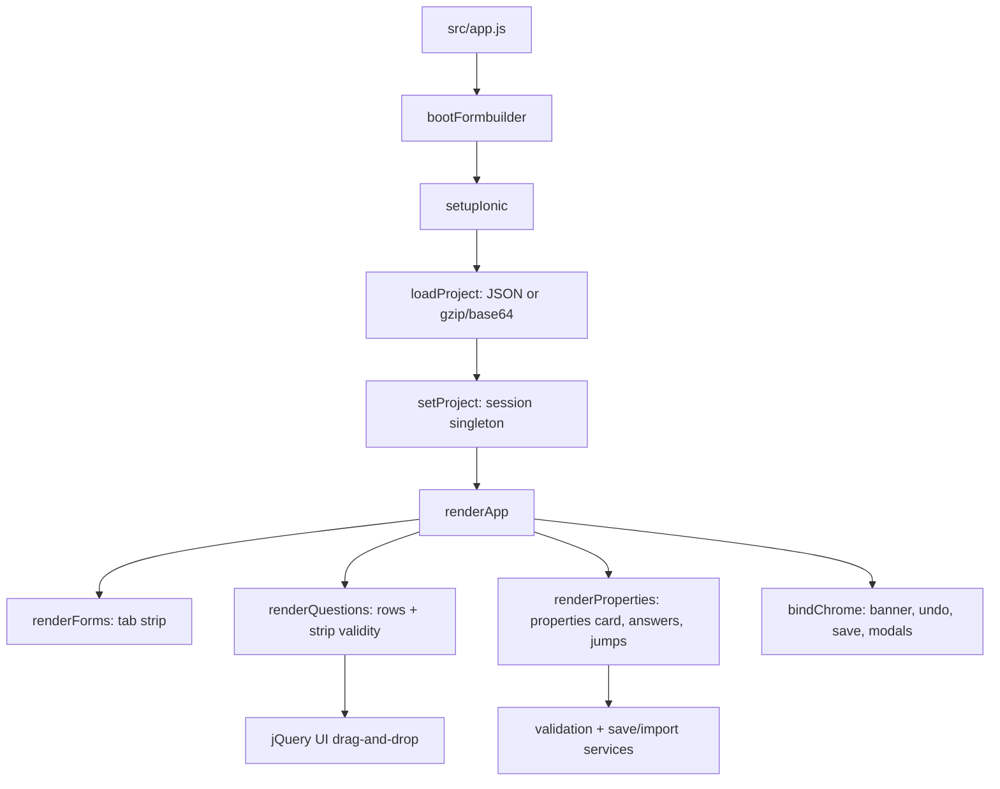
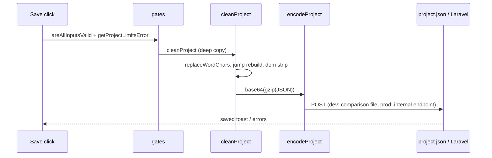

# Epicollect5 Formbuilder — Architecture

Source of truth for the system's design. Read it before changing anything;
cross-check any candidate finding against it.

This repository holds the **legacy formbuilder**, an **isolated Ionic UI
prototype**, and, eventually, a **Vue port**. They are independent: different
stacks, different architectures, different style rules. Never mix them.

| | Legacy formbuilder | Vue port |
|---|---|---|
| Path | `js/`, `css/`, `public/` | `formbuilder-vue/` |
| Stack | ES5 CommonJS, Browserify, jQuery 2.2.1, jQuery UI 1.11.4 | Vue 3, Pinia, Vite, Ionic Vue 8, `@vue-dnd-kit/core` (intended) |
| UI | Bootstrap 3 markup + Font Awesome | Port-owned components + SCSS theme |
| Tests | Mocha 2.5 + Chai + jsdom | Vitest 5 + jsdom |
| Style rules | frozen, see `AGENTS.md` | `docs/CODE-STYLE.md` |
| Status | in production | greenfield — no source on `master` |

## Ionic prototype (`formbuilder-ionic/`)

The active codebase: a full re-implementation of the formbuilder services and
UI over Ionic components. The legacy app is the behavioural reference and runs
side-by-side in development, but none of its modules are bundled — the only
inherited runtime dependency is jQuery UI for drag-and-drop:

- `src/services/**` and `src/models/**` re-implement validation, jumps, limits,
  undo, save, import and export against the same project-definition contract.
- `src/views/**` re-authors the containers and partials as Ionic markup
  (bundled via `?raw` imports).
- `src/theme/**` styles the port's own classes on Ionic tokens; no Bootstrap
  stylesheet is loaded.
- `src/ui/**` provides the interaction layer: drag-and-drop over jQuery UI,
  modals hosting the legacy `.modal` markup, dropdowns, toasts, the wait
  overlay and the Tiptap readme editor. Icons are Ionicons only
  (`<ion-icon>`); no Font Awesome.
- Tests are Vitest 5 + jsdom; harness suites drive the legacy modules directly
  as the behavioural gate.

jQuery UI stays for drag-and-drop only. The output is `formbuilder-ionic/dist/`,
served with the legacy `public/` and the shared `project/` mount so both entries
resolve `../project/project.json` identically. The prototype's architecture is
documented in **Part 2**; its risk register is
`formbuilder-ionic/docs/risks.md` and `formbuilder-ionic/README.md` carries the
build and test commands.

---

# Part 1 — Legacy formbuilder (`js/`, `css/`, `public/`)

A single-page formbuilder for Epicollect5 projects. The server renders
`public/index.html`; everything after that is jQuery and DOM manipulation.

## Entry point and boot order

`public/index.html` loads, in order:

1. jQuery **2.2.1** from a CDN
2. Bootstrap 3.3.6 JavaScript from a CDN
3. `js/vendor-formbuilder.js` (concatenated vendor globals: CircularJSON, Flatted,
   FileSaver, PapaParse, pako, toastr, summernote, jQuery UI, numeric input)
4. `js/formbuilder.js?v=<cache buster>` (the Browserify bundle)

`js/app.js` is the only application entry:

```js
$.when(load_project()).then(function () {
    $.when(load_components(), extend_natives()).then(init);
});
```

- `loaders/load-project.js` reads `#formbuilder-version` from the page, calls
  `utils.setProjectURL()`, fetches the project definition and stores it on the
  `formbuilder` singleton.
- `loaders/load-components.js` fetches the four containers, the partials and the
  per-input-type property views, injects the first form ref into the first tab,
  and calls `formbuilder.setup(ref, partials, views)`.
- `config/extend-natives.js` adds `Array.prototype.move`, `String.prototype.trunc`,
  `startsWith` and an `indexOf` fallback.
- `config/init.js` binds every UI handler, sets the project name and logo, renders
  the project, pushes the initial undo state and reveals the UI.

## Runtime singleton

`js/app_modules/config/formbuilder.js` is a mutable module singleton. There is no
store and no event bus; every module imports the same object.

It holds:

- `project_definition` — the project JSON currently being edited
- `current_form_ref`, `current_form_index`, `current_input_ref`
- branch/group editing flags and the active branch/group refs
- `state` — the undo stack (deep copies of the project definition)
- `dom` — cached jQuery handles (`input_properties`, `inputs_collection`,
  `forms_tabs`, `save_project_btn`, partials, property views, …)
- `render_action` — `do` / `undo` / `validate`; guards undo-state pushes
- `possible_answers` — pagination and sortable bookkeeping

`formbuilder.setup()` fills `dom` once the containers are loaded. Selectors are
cached with ref-scoped ids (`#<form-ref>-inputs-collection`, …); after a form is
created or removed, `form_factory.updateFormbuilderDomReferences(form_ref)` must
point them at the new markup.

## Project definition

The shape is the Epicollect5 API JSON:API form:

```json
{
  "data": {
    "type": "project",
    "project": {
      "ref": "…",
      "name": "…",
      "small_description": "…",
      "access": "…",
      "slug": "…",
      "status": "…",
      "visibility": "…",
      "logo_url": "…",
      "forms": [
        {
          "ref": "…",
          "name": "…",
          "slug": "…",
          "type": "hierarchy",
          "inputs": [
            {
              "ref": "…",
              "type": "text",
              "question": "…",
              "is_title": true,
              "is_required": false,
              "uniqueness": "none",
              "regex": "",
              "default": "",
              "verify": false,
              "max": "",
              "min": "",
              "datetime_format": "",
              "set_to_current_datetime": false,
              "possible_answers": [],
              "jumps": [],
              "branch": [],
              "group": []
            }
          ]
        }
      ]
    }
  }
}
```

A project object has exactly `name`, `small_description`, `access`, `slug`,
`ref`, `status`, `visibility`, `logo_url`, `forms`; `js/test.js` asserts that
key set. A form object has exactly `name`, `slug`, `type`, `ref`, `inputs`. An
input object carries the properties of its type; the import validator compares
the key set against the valid structure (`utils.hasSameProps`), so an unexpected
key is a validation failure.

Refs are built by appending `_<uniqid>` at each level:

- form ref = project ref + `_` + uniqid
- input ref = form ref + `_` + uniqid
- branch/group ref = owner input ref + `_` + uniqid

`utils.generateUniqID()` is a PHP-style uniqid; refs are opaque. Do not parse
them beyond the documented `getBranchOwnerInputRef` / `getGroupOwnerInputRef`
helpers.

On render, each input object receives a `dom` property: jQuery handles, the
rendered element, validity flags. **`dom` is runtime-only.** Save and export
delete it (`doCleaningBeforeSaving`, `export_form_click_callback`).

## Input model

- `factory/input-factory.js` maps a type string to a constructor.
- `factory/input-prototype.js` and `input-multiple-answers-prototype.js` provide
  the shared behaviour; `input-properties.js` holds the property panel metadata.
- `inputs/<type>.js` defines each question type's markup, default properties and
  property-panel hooks. There are 18 modules: text, textarea, integer, date, time,
  radio, checkbox, dropdown, barcode, location, audio, video, photo, phone,
  readme, branch, group, search.
- The palette in `public/views/containers/inputs-tools.html` offers 19 types:
  the 18 above plus `searchsingle`; `search.js` implements both `searchsingle`
  and `searchmultiple`, and `integer.js` implements both `integer` and
  `decimal` (the numeric type is a property of the input, not a separate
  module).
- Branches and groups are recursive containers. A branch can contain inputs and
  nested groups; a group can contain inputs but not branches or groups. The
  import validator enforces those nesting rules.

## Rendering

`actions/parse/` is the render orchestrator:

- `renderProject(project_definition)` creates forms, tab buttons and tab panels.
- `renderChildForms` renders additional forms.
- `renderInputs` turns input objects into factory instances and markup.
- `getBranchInputsHTML` / `getGroupInputsHTML` render nested containers.
- `initFormbuilder` rebinds DOM references, validation and handlers after an
  undo or a form switch.

`template/` builds the HTML strings for the properties panel: basic properties,
uniqueness, advanced properties, possible answers and their pager, the jump tab
and the jump list, and the input tool markup. The form tab button and tab
content markup lives in `helpers/ui.js`, which also owns the small UI state
changes (validation icons, save/undo buttons, title warnings, search-tool
visibility).

Views are runtime assets in `public/views/`:

- `containers/` — navbar, inputs tools, inputs collection, input properties
- `partials/` — tabs, property sections, possible answers, jumps, modals
- `properties/` — one property panel per input type

They are fetched with `$.get(path + file + '?v=' + FORMBUILDER_VERSION)`. A
missing view is a runtime error, not a build error.

## Editing UI

- jQuery UI `draggable` copies an input tool into the collection; `sortable`
  reorders inputs and updates the project definition.
- Branch, group and nested-group sortables are separate handlers because their
  containers are nested.
- The properties panel is delegated: click, change, focus, keyup and title
  checkbox handlers are attached to the panel and dispatch by DOM class.
- Forms are tabs; adding/removing a form re-renders the tab list and the tab
  content and then refreshes the cached DOM handles.

## Validation

`actions/validation.js` is the single validation entry point.

- `performValidation(input, showToast)` validates one input and writes
  `dom.is_valid` plus the error state in the UI.
- `areAllInputsValid(project_definition)` and `areFormInputsValid(index)` gate the
  save/export buttons and the form-tab icons.
- `validateBranchInputs` / `validateGroupInputs` recurse into nested containers.
- `validateBeforeSaving(form_ref, inputs)` re-runs the import-grade rules before
  the save POST.
- `isJumpValid`, `isPossibleAnswerValid`, `isMinMaxValueValid`,
  `isInitialAnswerValid` are the individual rules.

Limits come from `config/consts.js`: 300 inputs per form, 100 form-name chars,
50 form/input-name chars, 255 question chars, 1000 readme chars, 3 titles per
form/branch, 300 possible answers (1000 for search inputs), 5 search inputs per
project, 10 undo states.

## Jumps

Jumps are forward-only and live on each input's `jumps` array:

```json
{ "to": "<input-ref>", "when": "ALL|IS|IS_NOT|NO_ANSWER_GIVEN", "answer_ref": "…" }
```

- `utils.getJumpAvailableDestinations(input, inputs)` excludes the immediately
  following question (it would be a no-op) and offers `END` only when at least
  one question would actually be skipped.
- `getJumpAvailableDestinationsAsKeys` is the same set as a lookup object, used
  by save/import validation.
- Multiple-answer inputs require an `answer_ref` except for `ALL` and
  `NO_ANSWER_GIVEN`; single-answer inputs only allow `ALL`.
- Jumps are not allowed on inputs inside a group; the import validator rejects
  them.
- `sanitizeLegacyInvalidEndJumps` clears jumps on the last input and on the last
  branch input during import, because older exports could contain a jump to
  `END` that no longer skips anything.
- `doCleaningBeforeSaving` normalizes each jump to exactly
  `{ to, when, answer_ref }` and nulls `answer_ref` for `ALL` /
  `NO_ANSWER_GIVEN`.

## Possible answers

Multiple-answer inputs own a `possible_answers` array of
`{ answer, answer_ref }`.

- `actions/possible-answers.js` and `possible-answers-pager.js` handle add,
  delete, reorder and pagination (100 per page). The maximum is 300 answers per
  input, 1000 for the two search types.
- Possible answers can be imported from CSV (`PapaParse`) and exported to CSV
  (`FileSaver`); the CSV import modal offers replace/append and a column picker.
- `answer_ref` is 13 alphanumeric characters (`^[a-zA-Z0-9]{13}$`) and must be
  unique within the input.
- Deleting an answer leaves any jump that referenced it dangling — the
  "confirm before dropping the jump" check is still a TODO in
  `removePossibleAnswer`. A dangling `answer_ref` then fails
  `areJumpsValid` at save/import time.

## Undo

`actions/undo.js` keeps at most `LIMITS.max_states` (10) deep copies.

- `pushState()` serializes the project definition with Flatted, plus the active
  refs/tab, and is skipped while `render_action === 'undo'`.
- `execute()` pops the stack, re-renders the whole project, restores the active
  context and rebinds the UI.
- The initial state is pushed by `init` after the first render.

## Save pipeline

`ui-handlers/event-handler-callbacks/save-project-click-callback.js`:

1. Validate the currently selected input.
2. Deep-copy `formbuilder.project_definition` with Flatted.
3. `save.doCleaningBeforeSaving(forms)` — strips `dom`, replaces Word smart
   characters in questions, clears the legacy `group` array on branch inputs,
   normalizes jumps and validates jump destinations.
4. `validation.validateBeforeSaving(form.ref, form.inputs)` for every form.
5. POST the result to `consts.PROJECT_URL` as
   `base64(gzip(JSON.stringify(project_definition)))`.
6. On success, hide the overlay and show the saved toast; on failure, show the
   server error titles.

There is no save queue and no retry. The local standalone build posts to
`../postdump/index.php`; the Laravel build posts to
`api/internal/formbuilder/<project-slug>`.

## Import and export

### Export a form

`export_form_click_callback` deep-copies the project, validates the selected
form, strips `dom`, wraps the form as:

```json
{ "data": { "id": "<form-ref>", "type": "form", "form": { … } } }
```

and downloads `<project-slug>__<form-slug>.form.epicollect.json` with FileSaver.

### Import a form

`import_form_click_callback`:

1. Requires a `.json` file and parses it.
2. `helpers/import-form-validation.js` validates the wrapper
   (`data.type === 'form'`, `data.form.type === 'hierarchy'`), the input tree,
   refs, possible answers, jumps and limits.
3. Clears legacy invalid end jumps.
4. Rewrites the imported form ref to the current form ref in the serialized JSON
   (a global string replace), then re-parses.
5. Renders the inputs through the normal parse/factory path and replaces the
   current form's inputs.
6. Re-runs validation, toggles the save/export/print buttons and pushes undo
   state.

The import replaces the current form's inputs; it does not append them.

## URL and configuration

`helpers/utils.js` derives the environment from `window.location`:

- **Standalone local build** (`localhost` + path containing
  `epicollect5-formbuilder`): `PROJECT_URL = ../project/project.json`, views stay
  at `views/`.
- **Laravel**: the project slug is the second-to-last path segment; the domain is
  the path with the last three segments removed; `PROJECT_URL =
  <domain>/api/internal/formbuilder/<slug>`. `VIEWS_PATH` is always rewritten to
  an absolute path — `/views/` at the root, `/<subpath>/views/` when the app is
  mounted under a subpath.
- **Logo**: `api/internal/media/<slug>?type=photo&name=logo.jpg&format=project_mobile_logo&v=<project-definition-version>`.

`consts.VIEWS_PATH` is mutated at runtime; every loader reads it at call time.
`public/index.html` carries two cache-buster fields that must be bumped together:

- `<meta id="formbuilder-version" data-version="…">` — read by `load_project`
  and appended to every view request
- `<script src="js/formbuilder.js?v=…">` — busts the app bundle

## Styling

Sass, compiled by gulp — **no JS file imports a stylesheet**.

- `css/sass/*.scss` → `public/css/formbuilder.css` (minified)
- `css/paper/bootstrap-material.scss` → `css/vendor/bootstrap-material.css`
- `css/vendor/*.css` (Bootstrap Material, Font Awesome, Summernote, toastr) →
  `public/css/vendor-formbuilder.css` (minified)

The shared partials `_variables.scss`, `_mixins.scss` and `_media-queries.scss`
are used by every other partial; changing one silently changes every component.

## Build

```bash
npm run build     # gulp default: vendor-js → vendor-css → sass → browserify
gulp watch        # watchify, unminified public/js/formbuilder.js
gulp debug        # unminified bundle, no watchify
```

`gulpfile.js`:

| Task | Reads | Writes |
|---|---|---|
| `vendor-js` | `js/vendor/*.js` | `public/js/vendor-formbuilder.js` |
| `vendor-css` | `css/paper/bootstrap-material.scss`, `css/vendor/*.css` | `css/vendor/bootstrap-material.css`, `public/css/vendor-formbuilder.css` |
| `sass` | `css/sass/*.scss` | `public/css/formbuilder.css` |
| `browserify` | `js/app.js` + the `js/app_modules` tree | `public/js/formbuilder.js` (+ ignored `.map`) |

Browserify is configured with `paths: ['./node_modules', './js/app_modules']`
and `debug: true`; the production task adds `uglify`, `stripDebug` and a
`//Build number:` header.

All four output files are **tracked**. `npm run build` therefore rewrites tracked
artifacts; do not run it for docs-only work.

## Tests

Mocha 2.5 + Chai + jsdom, run in Node:

```bash
npm test
# mocha --require ./js/test/setup-node.js --reporter dot js/test.js

VERBOSE=1 npx mocha --require ./js/test/setup-node.js js/test/<name>.test.js
```

`js/test/setup-node.js`:

- sets `NODE_PATH` to `js/app_modules` + `js/test` so Browserify-style absolute
  requires work in Node
- builds a jsdom window and exposes `window`, `document`, `$`, `jQuery`, …
- loads jQuery **3.7.1** from `node_modules` (the browser uses 2.2.1)
- evaluates `public/js/vendor-formbuilder.js` in the window, then loads
  CircularJSON, Flatted and Papa in the Node realm so object prototypes match
- replaces `jQuery.ajax` with a file-system reader rooted at `js/test/`
- buffers `console.log` unless `VERBOSE=1`

`js/test.js` is the aggregator: every test file must be `require`d there or it
never runs. The suite is green (155 passing). Known defects, including the
unregistered `isJumpValid.test.js`, are listed in
`docs/legacy-known-defects.md`.

---

# Part 2 — Ionic prototype (`formbuilder-ionic/`)

An Ionic-component builder over a TypeScript-free re-implementation of the
formbuilder services. One execution context — the browser — and two serving
contexts: the **comparison dev server** (Vite middleware serving the legacy
builder side-by-side, the shared `project/project.json` and a local save
endpoint) and the **built bundle** (static files served by the Laravel app,
posting to its internal endpoints).

## Stack

| Concern | Choice |
| --- | --- |
| Build | Vite 8.3.6 (Rolldown), `target: 'es2020'`, no legacy plugin |
| Tests | Vitest 5.0.5 + jsdom |
| UI | Ionic 8.8.4 components consumed as custom elements — the DOM is built with `element()`/`createView()` helpers, no Angular/React/Vue binding |
| Editor | Tiptap 3.31.3 (readme) |
| Import validation | Ajv 8.20 + ajv-formats against `schemas/project.schema.json` |
| Drag and drop | jQuery 4.0.0 + jQuery UI 1.14.2 |
| Styling | Sass 1.108 |
| Language | Plain ESM JavaScript — no TypeScript, no router, no state library |

## High-Level Architecture



## The State Model

`src/services/session.js` is the single state container. There is no store
library and no event bus.

- `session.project_definition` — the project JSON currently being edited
- `session.current_form_index` — the active form
- `session.current_input_ref` — the selected question
- `session.editing` — a stack of container refs (branch/group), outermost first

Consequences:

- The project definition is **the** state: every change mutates it and
  triggers a re-render; no view keeps its own copy.
- The editing stack holds refs, not objects — every read walks the
  definition again, so container edits can never go stale.
- DOM-only state (answer pagination, notices, the open modal, scroll
  positions) lives in `ui/shell.js`, keyed by input ref.
- `change_revision` + `unsaved_changes` drive the beforeunload gate and the
  save button; the saved revision is bumped only by a successful save (R-72).

## Rendering

`ui/shell.js` (~2600 lines) is the only view module.

- `renderApp()` → `renderForms()` (the tab strip), `renderQuestions()` (the
  rows and the strip validity icon), `renderProperties()` (the properties
  card: tabs, basic/advanced fields, possible answers, jumps), `bindChrome()`
  (banner, undo, save).
- Every change mutates the session state and calls `recordChange()`: the undo
  push (500 ms typing throttle), the change revision, the debounced save gate,
  the scoped form-tab refresh and a re-render of the affected card.
- DOM preservation across re-renders: the properties scroll position, the
  active property tab and the per-form answer pages survive; the readme
  editor is destroyed and rebuilt.
- The form tab strip: content-sized flex tabs (max 220px, min 44px), the
  active tab keeps its name and count badge, inactive tabs collapse to a
  centred dots placeholder (plus the validity icon when invalid) once there
  are four or more forms, container queries collapse narrow tabs further, no
  scrollbar.
- Alignment rules: tab labels are flex (never inline) and their margins are
  zeroed — Ionic rewrites the slotted label margins when a button holds an
  icon (icon-top layout), which shifted labels ~6px.

## Validation architecture

Two layers, mirroring the data shape:

- `models/validation.js` — object-level rules per input: question text and
  length, possible answers (count, empties, duplicate refs), numeric ranges,
  initial answer vs min/max and regex, container children.
- `services/validation.js` — list-aware rules that need the surrounding list:
  jump destinations and conditions, container validity, form and project
  aggregations (`areFormInputsValid`, `areAllInputsValid`).

Every error carries the tab it belongs to (basic / advanced / jumps), so
surfacing is data-driven:

- the row badges and the strip validity icon,
- the tab badges (red text + the alert icon; from four forms on the inactive
  tabs collapse to dots),
- the message under the question text (basic-tab errors only),
- the per-jump-row messages under the offending field,
- the container toolbar icon and the debounced save gate.

The keystroke path is scoped to the edited form and the save-gate recompute is
debounced (R-41); the Validate button re-checks the selected question and
toasts.

## Save flow



- The gates run the whole contract: per-input validation, project caps (300
  inputs per form, 3 titles per list, 5 search questions per project), and a
  second jump-destination pass during cleaning.
- The payload is `base64(gzip(JSON))`; the comparison dev server writes
  `project/project.json`, production posts to the Laravel internal endpoint.
- No queue, no retry; the click is guarded by the `saving` flag and an edit or
  an undo during the POST keeps the project marked unsaved (R-72).
- The Compression Streams are polyfilled lazily on browsers missing them
  (R-66).

## Import and export

- **Export** gates on form validity and downloads the
  `{ data: { id, type: 'form', form } }` envelope as plain JSON.
- **Import** caps the file at 5 MB, validates it against
  `schemas/project.schema.json` (envelope, input tree, refs, possible
  answers, jumps, legacy end jumps), remaps the imported refs onto the
  current form ref, checks the imported form's own limits, and reports the
  whole-project runtime validity. It replaces the current form's inputs; it
  does not append them (R-67).

## Undo

- Up to 10 snapshots of the project definition (JSON deep clones) with a
  500 ms typing throttle; a push that changes nothing is skipped.
- The baseline follows project identity: a fresh `loadProject` resets the
  stack.
- Undo restores the definition; the form index is clamped and the property
  tab resets to basic. Measured cost and limits: R-62.

## Drag and drop

- `ui/sortable.js` is the only jQuery consumer (jQuery 4 + jQuery UI 1.14.2):
  `installToolDrag` (palette buttons drop into the question list; the drop
  index is resolved from the pointer because jQuery UI's
  `connectToSortable` never transfers the helper), `installQuestionSortable`
  (the question list, contained to the strip) and `installAnswerSortable`
  (the possible-answers rows, page-local, with a cancel selector so typing
  never starts a drag).
- jsdom cannot drive jQuery UI: the suite asserts init and calls the stop
  handlers directly (R-03); the behaviour is verified in the browser.
- The swap options (SortableJS, Pragmatic DnD, hcg-sortable) were evaluated
  and rejected for this prototype — see the audit in `docs/jquery-usage.md`.

## The legacy boundary

- The legacy app is frozen and is **not** bundled: the comparison server
  serves it side-by-side and both entries read the same
  `project/project.json`.
- The harness suites (`tests/support/properties-panel.js`) drive the legacy
  modules directly as the behavioural gate for jumps, possible answers and
  the properties panel.
- `docs/PORTING.md` and `docs/legacy-known-defects.md` document what is
  ported and what is deliberately not (the port does not reproduce legacy
  defects).

## Error handling

- `notifyError` / `notifyWarning` / `notifySuccess`: one `ion-toast` at a
  time at the top of the page (R-74).
- Field-level errors: the message under the question text (basic-tab errors
  only), per-jump-row messages under the offending field, the tab badges and
  the row badges.
- The wait overlay wraps save/import/undo; every show has a hide on both
  branches (R-75).

## Constraints and tradeoffs

- The session singleton + full re-render: a simple single-source-of-truth
  data flow, at the cost of DOM churn on large projects (R-41 numbers, R-62
  clone cost).
- `ui/shell.js` is one large module: rendering, chrome binding, gates and
  drag wiring in one place — easy to find, hard to split without a view
  framework.
- jQuery UI is the drag layer and the last legacy runtime dependency; the
  swap options were evaluated and rejected until the drag flows are
  browser-verified.
- No TypeScript and no router: the URL is static; the beforeunload gate is
  the only navigation guard.
- The prototype scope is the formbuilder itself: five forms, 300 questions
  per form, the caps in `PARAMETERS` — enforced by the save gate.

## Mental model

1. The project definition in the session is the only state; services mutate it.
2. Every mutation goes through `recordChange`: undo push, revision, gates.
3. Rendering reads the state and rebuilds the cards; nothing caches.
4. Validation is derived, never stored; every error carries where it surfaces.
5. Save, import and export are the only IO; all of them validate the whole
   contract first.

---

# Part 3 — Vue port (`formbuilder-vue/`) — target

A Vue 3 rewrite of the same formbuilder. **Greenfield: there is no port source on
`master`.** The existing `formbuilder-vue` branch content is disposable and is not
a reference.

## Status

- The port will be written from scratch under `formbuilder-vue/`.
- `docs/CODE-STYLE.md` is the target style and applies only there.
- The legacy app remains the behavioural reference for the project-definition
  contract; it is not a structural template.
- CodeGraph indexes the repository except `public/js/**`, `js/vendor/**`,
  `css/paper/**` and `doc/**` (`codegraph.json`); port source is picked up once
  committed.

## Stack

| Concern | Choice |
|---|---|
| Framework | Vue 3 |
| Build | Vite |
| State | Pinia |
| UI | Ionic Vue 8 |
| Drag and drop | vue-draggable-plus (Vue 3 binding over SortableJS) — candidate |
| Tests | Vitest |

## Layout

Mirror the mobile app's actual `src/` layout:

```
formbuilder-vue/src/
  components/    reusable UI components
  pages/         route-level components
  stores/        Pinia stores
  services/      project load/save/import/export and other workflows
  models/        project-definition shapes, constants, factories
  use/           reusable Vue composition logic
  theme/         per-component SCSS, mirroring components/ 1:1
```

`@` resolves to `formbuilder-vue/src`.

## Contract

The port must accept and produce the same project-definition JSON as the legacy
app:

- same `data.project.forms[].inputs[]` shape and field names
- same ref composition rules
- same jump semantics (forward-only, `END` only when it skips something)
- same possible-answer limits and `answer_ref` format
- same import/export wrapper (`data.form`) and file names

Parity is defined by the legacy behaviour, not by the legacy code structure. If
the legacy code contains a defect, do not port the defect; see
`docs/legacy-known-defects.md`.

## Style

`docs/CODE-STYLE.md` — Vue port only. The legacy app is not restyled.

---

# Build, release and deploy

## Legacy

```bash
npm test          # mocha --opts js/test/mocha.opts
npm run build     # gulp default
gulp watch        # watchify dev bundle
```

Deployable tree: `public/index.html`, `public/js/`, `public/css/`,
`public/views/`, plus the static `public/fonts/` and `public/favicons/`.

## Vue port

`formbuilder-vue/` will have its own `package.json` and Vite build output. Its
`dist/` is **not** the legacy `public/` tree; never mix them in a release.

## Release

1. `npm test` — the legacy suite must be green before any version change.
2. Determine the version (see below).
3. Bump `package.json` and both `package-lock.json` version fields.
4. Prepend the release notes to `CHANGELOG.md`.
5. `npm run build` — rebuild the four tracked artifacts.
6. Bump both cache-buster fields in `public/index.html` to the same fresh value.
7. Commit (`chore: release <version>`) and create the annotated tag `X.Y.Z`.
8. **Ask before pushing.** Show what would go out — the branch, the number of
   commits and the tag — and wait for an explicit yes. A request to cut a
   release is not consent to push. Then push `master` and the tag.
9. **Ask before publishing.** Create the GitHub Release and upload the four
   built artifacts only after a separate confirmation naming the repository.
10. Deploy is a **separate, explicit** step: copy the deployable tree into the
    EpiCollect5 server's `public/formbuilder/` directory. There is no deploy
    script. Bump the server's own `config('app.release')` cache-buster when the
    shell or views change, so production does not keep serving the previous
    release.

The full procedure, including the confirmation wording, is in
`.agents/skills/release/SKILL.md`.

## Versions

The release version is plain semver `X.Y.Z`.

- The latest git tag is **`0.1.0`**.
- `package.json` and both `package-lock.json` version fields read **`0.1.0`**;
  they are in sync with the tag.
- `CHANGELOG.md` exists and carries an entry for every tagged version, back to
  `0.0.2`.
- GitHub Releases carry the four built artifacts.

> **The git tag and the CHANGELOG heading are authoritative — not
> `package.json`.** Keep all three in sync.

> **Pushing always requires an explicit confirmation** — see `AGENTS.md`,
> "Pushing always requires explicit confirmation".
